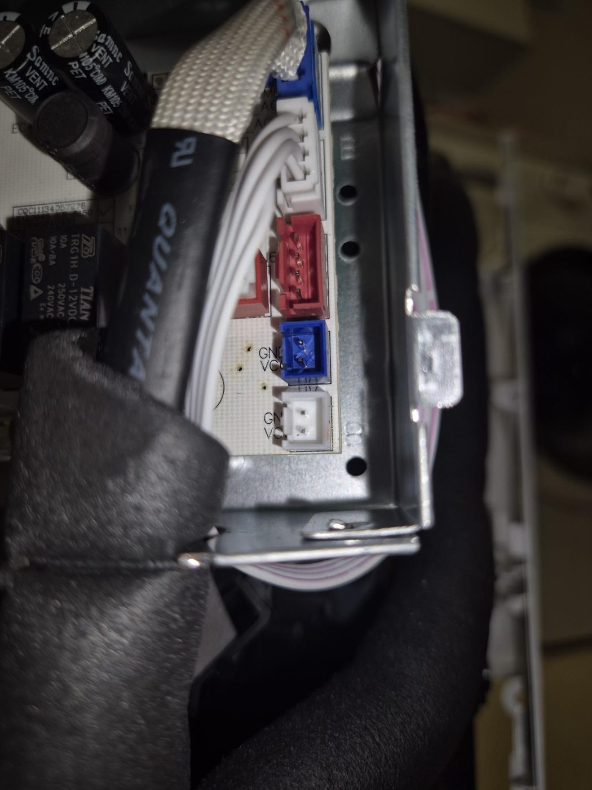
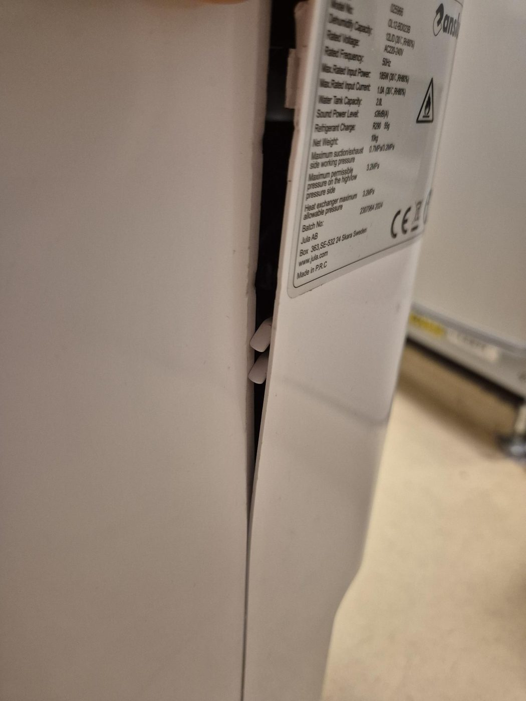
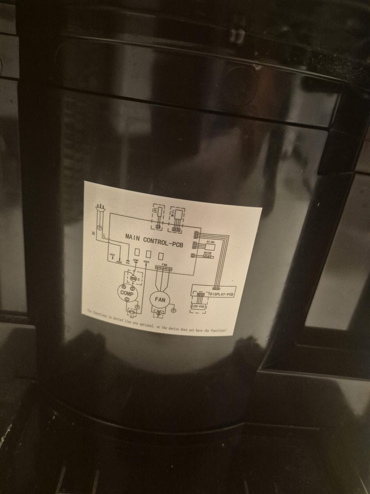
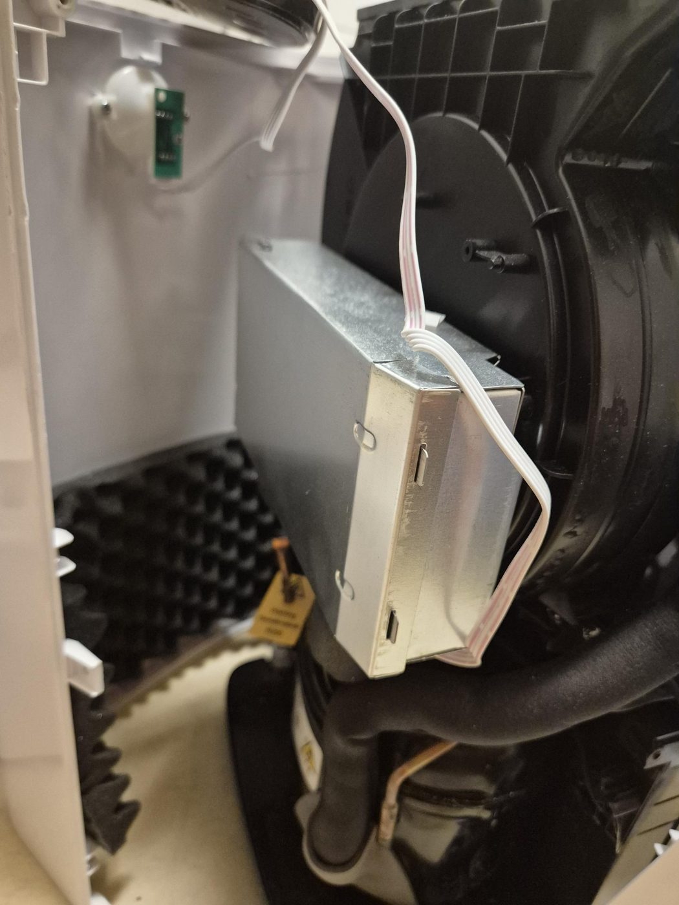
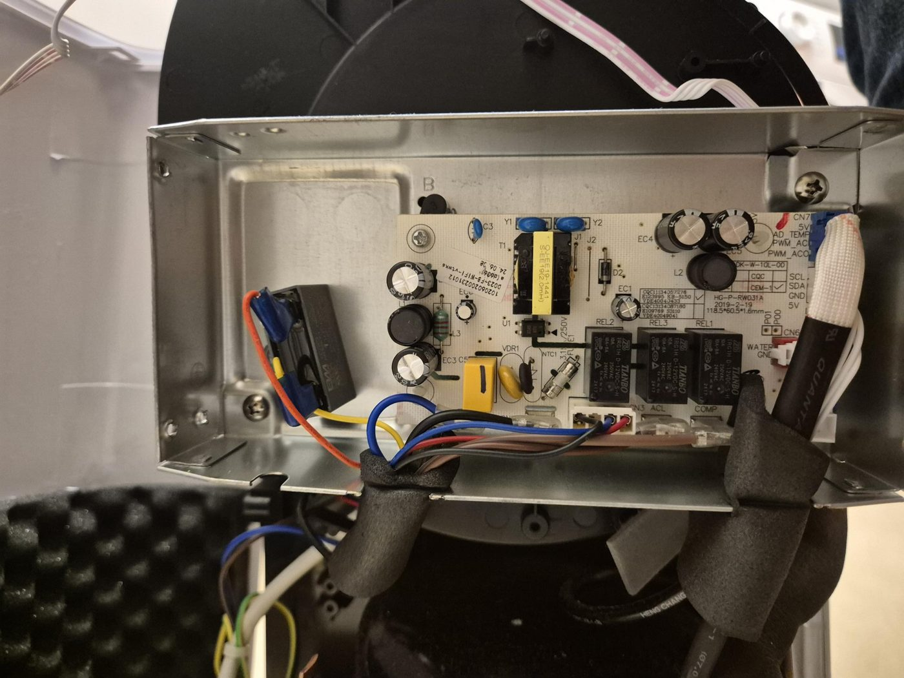
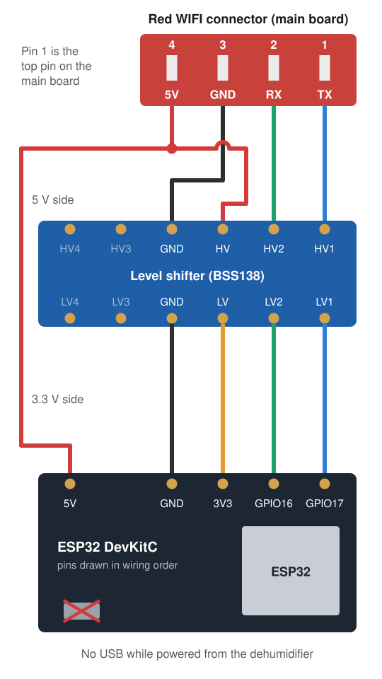

# Anslut 025966 dehumidifier → Home Assistant (ESPHome)

Local, cloud-free control of the **Anslut 12 L dehumidifier** (Jula art. no. 025966, model OL12-BD023B) from Home Assistant.

The main board in this unit already has an unused **WIFI** connector, built for an optional Tuya Wi-Fi module that this model ships without. An ESP32 running ESPHome plugs into that connector and takes the module's place. No soldering on the dehumidifier, no changes to its firmware, and the original buttons keep working.

## What you get in Home Assistant

| Entity | Type | Notes |
|---|---|---|
| Power | switch | |
| Mode | select | Drying mode, Auto, Night |
| Target humidity | number | 30–80 %, steps of 5. Setting it switches the unit to Auto. |
| Fan speed | select | Low, High |
| Child lock | switch | |
| Humidity | sensor | The unit's own sensor |
| Temperature | sensor | |
| Water tank full | binary sensor | Also triggers when the tank is removed |
| Fault code | sensor | Raw fault bitmap (diagnostic) |

Changes made on the unit's own panel show up in Home Assistant right away, and the other way round.

## ⚠️ Safety and disclaimer

- **Unplug the dehumidifier** before opening it. The main board carries 230 V.
- The refrigerant is **R290 (propane)**. Never touch, bend or puncture the cooling circuit.
- Only probe the low-voltage connectors on the right edge of the main board. Stay away from the relays and the power supply on the left.
- Opening the unit likely voids the warranty. You do this **at your own risk**.

## Compatibility

Tested on: **Anslut 025966** (Jula), model OL12-BD023B, main board HG-P-RW031A, sticker "D023-F3-WIFI".

The same OEM unit appears to be sold under other names (e.g. Wessex 70488, and OL12-BD023 variants from other brands). These are **untested**. If the main board has a red 4-pin connector labelled WIFI, there's a good chance it works. Please open an issue or PR if you try one.

Tuya product ID reported by the unit: `xuvs0ixgfavtwksa` (MCU firmware 1.0.0).

## Parts

| Part | Notes |
|---|---|
| ESP32 development board | ESP32 DevKitC / WROOM-32 used here. Any ESPHome-supported ESP32 works with pin changes. |
| Bidirectional level shifter, 4 channels (BSS138) | The connector's signals are **5 V**; the ESP32 is 3.3 V. Labelled HV/LV. |
| Jumper wires or a JST XH 2.54 mm 4-pin cable | XH fits the WIFI connector directly. |
| Optional: perfboard, female headers | For a permanent build. |

Tools: screwdriver, plastic pry tool, multimeter, soldering iron (for the level shifter's pin headers, if not pre-soldered).

## 1. Open the unit

1. Unplug it and remove the water tank.
2. Remove the rear air filter grille. Unscrew the small white **humidity sensor box** clipped to the grille first, since its cable runs inside.
3. Remove the visible screws on the back panel.
4. The back panel is also held by **hook clips along both side seams**. Work a plastic pry tool into the seam, press each clip toward the inside of the unit and pull the panel outward. Start at the top and work down.

5. Inside the tank cavity there's a wiring diagram sticker. The dotted "WiFi" box on it is the connector we use.

6. The main board sits in a **metal box** next to the fan. Open its lid (sheet-metal tabs).

 

Note: the board under the top panel (with SCL/SDA) is only the **display board**. Don't connect anything there.

## 2. The WIFI connector

A red 4-pin JST XH connector on the right edge of the main board, labelled **WIFI**. Measured with the unit in standby:

| Pin | Function | Idle voltage |
|---|---|---|
| 1 (top) | Main board **TX** | ~4.7 V |
| 2 | Main board **RX** | 5.0 V |
| 3 | GND | 0 V |
| 4 (bottom) | 5 V supply | 5.0 V |

Protocol: **Tuya MCU serial**, 9600 baud, 8N1, 5 V logic.

The low-voltage side is fed by an isolated switch-mode supply. Still, **check isolation yourself** before connecting anything: with the unit unplugged, measure resistance between connector pin 3 (GND) and each pin of the mains plug. It should read open circuit.

## 3. Wiring

| WIFI connector | Level shifter | ESP32 |
|---|---|---|
| Pin 1 (TX) | HV1 ↔ LV1 | GPIO17 (RX) |
| Pin 2 (RX) | HV2 ↔ LV2 | GPIO16 (TX) |
| Pin 3 (GND) | GND (HV side) | |
| | GND (LV side) | GND |
| Pin 4 (5V) | HV | 5V |
| | LV | 3V3 |

The ESP32 is powered by the dehumidifier's own 5 V, so no external power supply is needed.

**Never plug USB into the ESP32 while it's connected to the dehumidifier.** Two power sources can feed into each other. To flash by cable, disconnect it from the dehumidifier first.

**Mount the ESP32 outside the metal control box**, or Wi-Fi reception will suffer.

## 4. Flash ESPHome

1. Connect the ESP32 to your computer by USB (not connected to the dehumidifier).
2. In Chrome or Edge, go to [web.esphome.io](https://web.esphome.io), click **Connect**, then **Prepare for first use**, and enter your Wi-Fi details.
   - No port showing up? Install the CP210x (or CH340) USB driver, or try another cable. Charge-only cables don't work.
   - Stuck on "Connecting…"? Hold the **BOOT** button while it connects.
3. In Home Assistant, open the **ESPHome Device Builder** add-on. The board appears as **Discovered**. Click **Adopt**.
4. Click **Edit**, keep the top part ESPHome generated (`esphome:`, `esp32:`, `wifi:`, `api:`, `ota:`), and paste everything from `uart:` downward from [`esphome/anslut-025966.yaml`](esphome/anslut-025966.yaml). Or use the whole file together with [`secrets.example.yaml`](esphome/secrets.example.yaml).
5. **Install → Wirelessly.** Wait at least two minutes without touching anything (see Troubleshooting).
6. Disconnect USB, wire it to the dehumidifier as above, and plug the dehumidifier in.

## 5. Datapoints

Mapped by pressing each button with the log open. Useful if you're adapting this to a similar unit.

| DP | Type | Function | Values |
|---|---|---|---|
| 1 | bool | Power | |
| 2 | int | Target humidity (%) | 30–80, step 5. Only used in Auto. |
| 4 | enum | Fan speed | 0 = Low, 1 = High |
| 5 | enum | Mode | 0 = Drying (continuous), 1 = Auto, 2 = Night |
| 6 | int | Current humidity (%) | |
| 7 | int | Temperature (°C) | |
| 16 | bool | Child lock | |
| 19 | bitmap | Faults | bit 0 = water tank full / removed |

Not mapped yet: the 12-hour **timer**. If you find its datapoint, a PR is welcome.

Night mode forces the fan to Low.

## Troubleshooting

**`Initialization failed at init_state 0` repeating every 15 s**
The ESP isn't getting answers. Most often RX/TX are swapped: swap `GPIO16` and `GPIO17` in the config and install again. Otherwise check GND on both sides of the level shifter, 5 V on HV and 3.3 V on LV, and that the dehumidifier is plugged in.

**`OTA rollback detected` and the old config is running**
ESPHome only keeps a new firmware if it runs 60 seconds without a restart. Install again and don't unplug or rewire anything for a couple of minutes.

**Changing target humidity does nothing**
The unit ignores it outside Auto mode. The config handles this by switching to Auto automatically when you change it from Home Assistant.

**Debugging the serial line**
Set `logger: level: DEBUG` to see every datapoint change. To see raw bytes, add a `debug:` section under `uart:` (see the [ESPHome UART docs](https://esphome.io/components/uart.html)).

## Roadmap

- [x] Tuya protocol confirmed, all main functions mapped
- [x] ESPHome config with Home Assistant entities
- [ ] Map the timer datapoint
- [ ] Perfboard build guide (ESP32-C3 SuperMini for a smaller footprint)
- [ ] Custom PCB: ESP32-C3, 3.3 V regulator, level shifting, JST XH connector
- [ ] Submit to [devices.esphome.io](https://devices.esphome.io)

## License

Code and configuration: [MIT](LICENSE). A hardware license will be added together with the PCB design.
